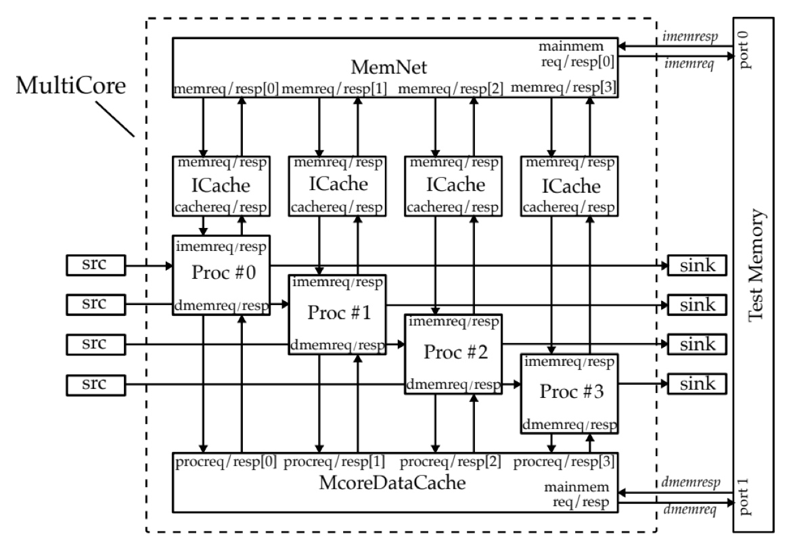
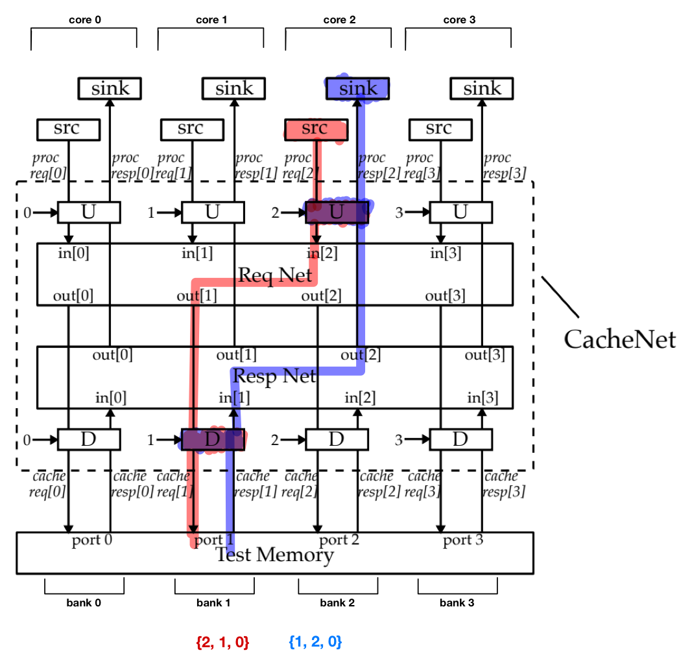

# riscv-proc - an extension of ECE 4750
Delving deeper into comp arch one step at a time, fu avneb 2eqha yh4r y.

## Current BHT implementation
### Dpath Illustration

  

### Design decisions
- starts in strictly not taken
- wired into dpath partially (would probably not do that in future)
- used AI for plumbing, it also made the drop unit a counter and the fetch queue 4 deep, to survive a mispredicted predicted-taken branch. (wierd bug idrk)
### Notes
- study up on ctrl logic changes

## 2D mesh NoC
### Mesh illustration

  

### Design decisions
- XY routing (no deadlocking)
- 2x2 mesh (the picture was made prior to multicore planning)
- round robin arbitration (see MeshSwitchUnit.v)
- Used AI for plumbing, learning, and intial cocotb tests
### Notes
- study up on Mesh.v and the Router

## Multicore system
### System

  

### CacheNet: core 2 `lw 0x2010` → bank 1

  

### Design decisions
- 4 cores
- stateless adapters (also only one design)
- same network for both (cache and memroy traffic)
- AI was used for plumbing, learning, intial testing

## Future Steps
- Full RISC-V compliance
- PyUVM verification
- Synthesis on Cyclone V
- C benchmarking
- Novel additions
  - Measuring, in real RTL, what each x86-compatibility assist costs RISC-V.
- A compiler???
- contribute to the open-source
