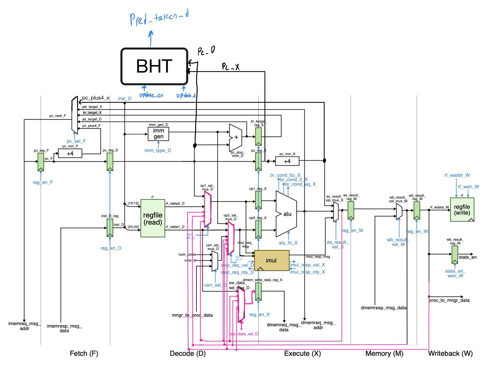
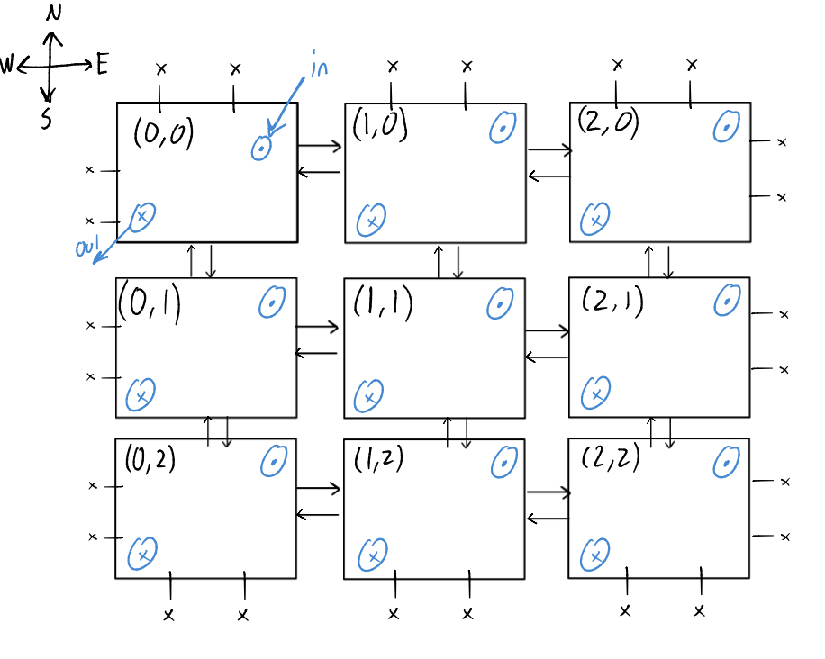

# riscv-proc
Delving deeper into comp arch one step at a time.

## Current BHT implementation
### Drawing

  

### Design decisions
- starts in strictly not taken
- wired into dpath partially (would probably not do that in future)
- used AI for plumbing, it also made the drop unit a counter and the fetch queue 4 deep, to survive a mispredicted predicted-taken branch. (wierd bug idrk)
### Notes
- study up on ctrl logic changes

## 2D mesh NoC
### Drawing

  

### Design decisiosn
- XY routing (no deadlocking)
- 2x2 mesh (the picture was made prior to multicore planning)
- round robin arbitration (see MeshSwitchUnit.v)
- Used AI for plumbing, learning, and intial cocotb tests